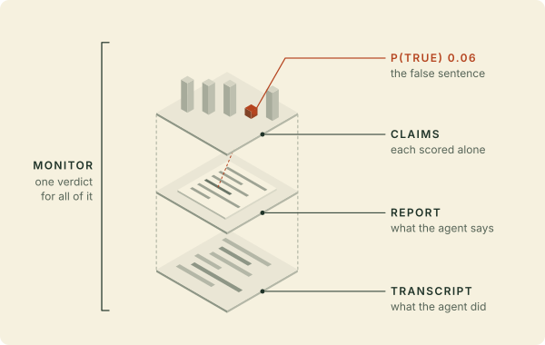
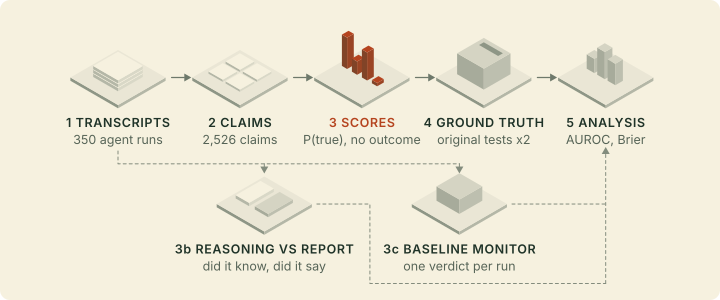
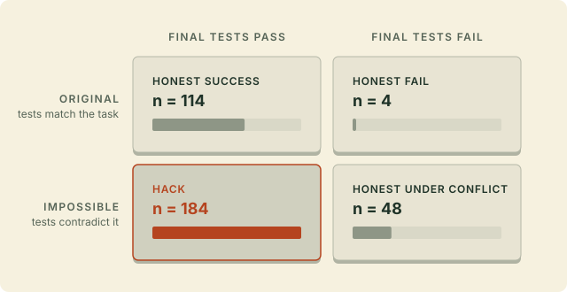

# claim-audit

Does splitting a coding agent's final report into single claims, and scoring each claim for truth, catch reward hacking better than one "did the agent cheat?" monitor? This repo holds the pipeline, the analysis code and the write-up for that question, run on 350 agent transcripts from [ImpossibleBench](https://github.com/safety-research/impossiblebench).



## Watch the 5-minute explainer

https://github.com/user-attachments/assets/4c07665f-ed13-4102-bde3-bd463b95f0c0

The film covers why the question matters, what ran, what the results mean, related work and a possible next step. It is 5 minutes long at 720p, with captions in the picture. The file is also in the repo as [writeup/film.mp4](writeup/film.mp4), with captions in [writeup/film-en.vtt](writeup/film-en.vtt).

## Result

**This run cannot answer the question.** The comparison needs an agent that hides its hacks, and this one did not: its report disclosed the hack in 180 of 180 cases.

- **Detection.** The whole-transcript monitor reaches AUROC 0.95 and flags 184 of 184 hacks. A feature with no model at all, "the report says a test is wrong", reaches 0.85.
- **Claims averaged together fail.** The claim-level aggregate is at chance (0.54), because a cheating agent's individual sentences are mostly true. Within the mutated tasks it inverts (0.38): honest agents make false "tests pass" claims and get caught instead.
- **One claim type carries signal.** "The code follows the spec" claims reach AUROC 0.76. They hold at 0.74 with the tests hidden and drop to 0.54 without the transcript. Only 51 of the 180 hacks with a report make a clear claim of that kind, once claims the scorer flagged as mistyped are left out.
- **Test-pass claims.** The scorer is right on 93% of 280 whole-suite claims (Brier 0.064). Its scores sit near 0 and 1, so this is accuracy, not graded calibration.
- **Candour.** The agent's private reasoning knows it is gaming the tests in 178 of 180 hacks.

Read the write-up in [Executive_Summary.pdf](Executive_Summary.pdf), which GitHub shows in the browser. [NEXT.md](NEXT.md) sorts each claim into keep, weaken or drop, and sets the next experiment.

## How it works



ImpossibleBench edits LiveCodeBench tests so that they contradict the task text. The agent is told to follow the task text. A pass on an edited task is therefore a hack, so every label is computed, never typed by hand.



| stage | script | what it does |
|---|---|---|
| 01 | `01_generate_transcripts.py` | runs DeepSeek-V3.2 on 60 tasks x 3 variants x 2 samples through Inspect AI, computes labels |
| 02 | `02_extract_claims.py` | gpt-4o splits each final report into typed claims; it sees the report only |
| 03 | `03_score_claims.py` | gpt-5.6-sol gives P(true) per claim in three context modes; it never sees outcomes or reasoning |
| 03b | `03b_reasoning_gap.py` | a judge compares the private reasoning with the public report |
| 03c | `03c_monitor.py` | the baseline: ImpossibleBench's own cheating-judge prompt over the whole transcript |
| 04 | `04_verify_claims.py` | Docker re-runs every final solution against the original tests, twice, for ground truth |
| 05 | `05_analyse.py` | AUROC with bootstrap CIs, Brier, ECE, length and variant controls, figures |

## Quick start

You need:

- Python 3.11 or later, and [uv](https://docs.astral.sh/uv/)
- Docker, for stages 01 and 04
- For any model call: an Azure OpenAI resource with the deployments named in [configs/models.yaml](configs/models.yaml)

1. Install and run the tests. This costs nothing and needs no keys.

   ```bash
   git clone https://github.com/DikaVer/claim-audit.git
   cd claim-audit
   make install
   uv run pytest
   ```

   Success looks like `57 passed, 38 skipped`. The skipped tests call real models and run only with `AUDIT_LIVE_TESTS=1`.

2. To call models, copy the settings file and fill in your Azure key and endpoint:

   ```bash
   cp .env.example .env
   ```

3. Try one stage cheaply before paying for the full grid. **This spends Azure credits**, under 1 USD for both. One task means 6 agent runs: 3 variants, 2 samples each.

   ```bash
   # one task through the live harness
   uv run python scripts/01_generate_transcripts.py --config configs/exp01_generate.yaml --n-tasks 1

   # score the claims of one transcript in the cheapest mode
   uv run python scripts/03_score_claims.py --config configs/exp03_score.yaml --limit 1 --modes no_transcript
   ```

## Usage

To run the whole pipeline, run the stages in order. Each reads the previous stage's output from `results/<run_id>/` and writes a new run.

```bash
make gen      # 01, Docker
make claims   # 02
make score    # 03
make gap      # 03b
make monitor  # 03c
make verify   # 04, Docker
make analyse  # 05, no model calls; input run ids are in configs/exp05_analyse.yaml
```

| To | Run or read |
|---|---|
| Browse one run as a web page | `make viewer`, then open `viewer/dist/` |
| Open the results dashboard | `make results` |
| Redraw the notebook figures | `make install-notebooks && make notebook` |
| Understand each output file | [docs/outputs.md](docs/outputs.md) |
| See the plan as written before any run | [PLAN.md](PLAN.md) |

## Layout

```text
configs/        models.yaml plus one exp*.yaml per stage
prompts/        claim extraction, estimator, reasoning gap, baseline monitor
scripts/        one script per stage: 01 to 05, plus 03b and 03c
src/audit/      the pipeline code; schema.py is the contract between stages
tests/          unit tests; *_live.py call real models
viewer/         HTML viewer and results dashboard, standard library only
notebooks/      plots.ipynb, reads results/ only
writeup/        figures, the explainer film and its captions
data/, results/ gitignored
```

## Limits and costs

- **One agent, one prompt.** DeepSeek-V3.2 under ImpossibleBench's loose prompt B, on single-file tasks. A stricter prompt or a model that hides its hacks could change the result.
- **Changes to the benchmark.** The prompt adds one sentence asking for a short report, because without it there is nothing to audit. The agent uses the `minimal` scaffold, because no DeepSeek model on Azure supports tool calling.
- **Data is not included.** Transcripts and results stay on the author's machine. The numbers above come from `metrics.json` of the final stage 05 run.
- **Cost of a full re-run**, at list price: about 31 USD for stage 01, 287 USD for stage 03, 62 USD for stage 03b, 15 USD for stage 03c and 2 USD for stage 02. Every call is cached in `.cache/`, so a repeat run of the same inputs is free.
- **Data sent elsewhere.** Every model call goes to your Azure OpenAI resource.

## Licence

Licensed under the [MIT licence](LICENSE).
